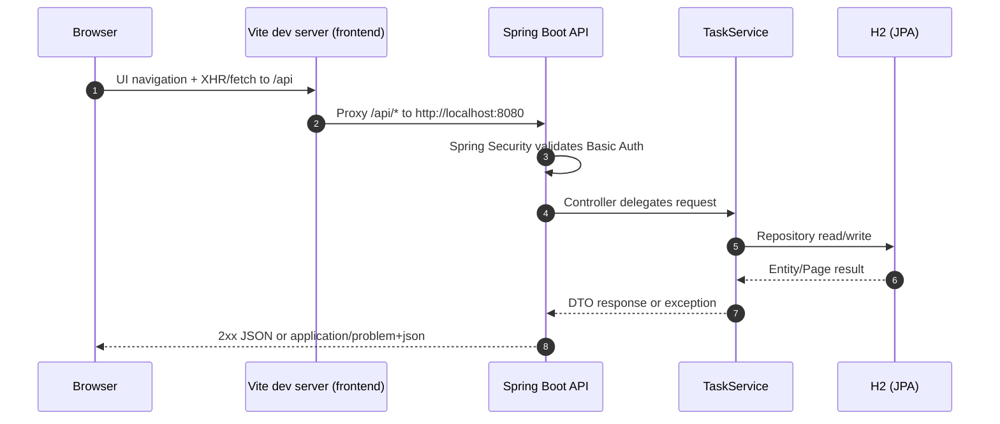

# Architecture Overview

This project consists of a Spring Boot backend REST API and a React + TypeScript frontend intended for **local development only**.

## Components

### Backend
- **Runtime**: Java 21, Spring Boot 3.5.x, Maven
- **API**: REST endpoints under `/api/tasks`
- **Persistence**: in-memory H2 database via Spring Data JPA
- **API documentation**: springdoc OpenAPI
  - Swagger UI (`/swagger-ui/**`) is public
  - OpenAPI JSON (`/v3/api-docs`) is public
  - OpenAPI YAML (`/v3/api-docs.yaml`) requires authentication
- **Error model**: RFC7807 Problem Details (`application/problem+json`)

### Frontend
- **Runtime**: React + TypeScript (Vite)
- **API access**: calls `/api/*` and relies on the Vite dev-server proxy to forward to `http://localhost:8080`
- **Credential storage**: in memory only (no localStorage/sessionStorage/cookies)

## Data flow

## Key architectural constraints

- **Single-user Basic Auth**: credentials are configured via environment variables.
- **Ephemeral storage**: H2 runs in-memory; data is lost on restart.
- **Local-dev frontend**: the built frontend output (`frontend/dist/`) is not deployable as-is because the `/api` proxy is a dev-server feature.
